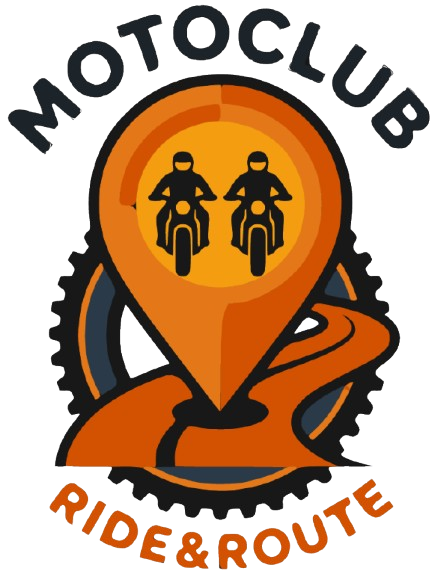
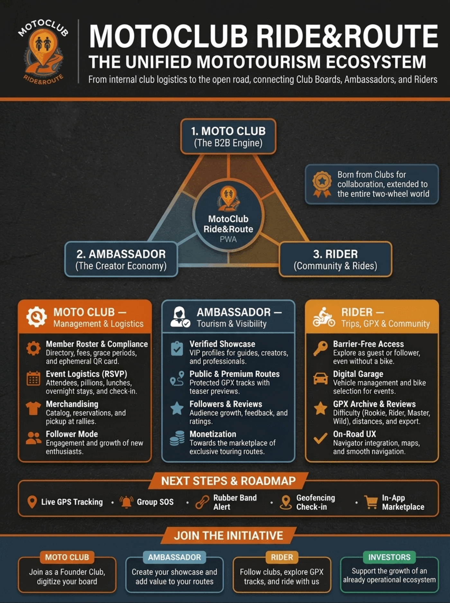

#  MotoClub Ride&Route 🏍️

> The ultimate B2B2C Multi-Tenant platform for Motorcycle Clubs, Ambassadors, and Riders. 
> Bridging the gap between club logistics (like *Spond*) and the riding experience (like *Rever*).

  

## 📖 Project Overview
**MotoClub Ride&Route** is a comprehensive, multi-tenant platform designed to solve the logistical nightmares of motorcycle club organizers, empower Moto-tourism Ambassadors to publish their curated routes and improve their visibility, and provide an easy way for all motorcyclists to manage their club memberships, discover beautiful itineraries, and participate in events. From streamlining club memberships and events, to offering riders a personal digital garage and a global repository of community-rated itineraries, it serves as the ultimate hub for the mototourism ecosystem.

Born from the real-world needs of **Riders Club Ryu (Royal Enfield Milano Nord)**, this platform eliminates the chaos of WhatsApp groups, spreadsheets, and scattered GPX files. 

### 🎯 Unique Selling Proposition
- **For Clubs:** Member management, membership fees, registrations and renewals, event management and fee collection, automated RSVPs, waitlists, restaurant headcounts, merch distribution, and pre-ride check-ins. Includes audience building via "Follower" mode (teaser events for non-members). Planned also real-time group tracking (SOS, rubber-band alerts).

- **For Ambassadors:** Dedicated and verified VIP profiles for motorcycle tourism professionals to publish curated itineraries. In future will include a built-in marketplace for Premium routes with flexible pricing models (single purchase, subscription, or lifetime access) and a revenue-sharing system, allowing creators to build their community and earn from their expertise.

- **For Riders:** Offers a personal digital Garage, and access to a global, community-rated repository of GPX itineraries classified by difficulty (Rookie, Medium, Advanced, Off-road). Manage own membership in multiple clubs or simply follow them to stay updated on public activities.

## 🛠️ Tech Stack
- **Frontend:** Progressive Web App (PWA) with offline-first capabilities, built with Vite, React, TypeScript, and Tailwind CSS (targeting Android, iOS, and Desktop Web).
- **Backend / BaaS:** PocketBase (SQLite, REST API, Realtime Server-Sent Events).

## ✨ Core Features
1. **Multi-Tenant Architecture:** Independent environments for different clubs with custom branding and public/private visibility. Includes support for mono-brand clubs (e.g., Royal Enfield).
2. **Comprehensive Member Management:** Complete control over club rosters, handling active memberships, annual renewals, fee tracking, and roles (from simple Followers to official Members and Coordinators).
3. **Advanced RSVP & Event Logistics:** Granular event planning (Day trips vs. Multi-day), capacity limits with automatic waitlists, and RSVP details (Pillion, Lunch, Overnight stay). Includes manual and QR-code based pre-ride check-ins for attendees. Event can be `Public`, `Public Teaser`, `Club & Followers-Only` or `Private`.
4. **Global Itinerary Repository:** A centralized, community-driven catalog for GPX routes. Routes can be strictly `Private`, `Club`-only, `Public` for the global community to explore and rate, or `Premium` (curated and monetized by verified Ambassadors). Includes direct GPX download for standard navigation devices.
5. **Club E-Commerce (Merch):** Reserve-now-pickup-later system for club merchandising, integrated with event check-ins for easy distribution.

### 🚀 Roadmap (Planned Features)
* **Live Group Tracking:** Ephemeral GPS tracking via PocketBase Realtime APIs for active events, providing Apripista (Lead) and Scopa (Sweep) with total visual control over the pack, including SOS and rubber-band alerts.
* **Dynamic Event Check-In:** Automatic attendance logging using geofencing upon arrival at the meeting point.

